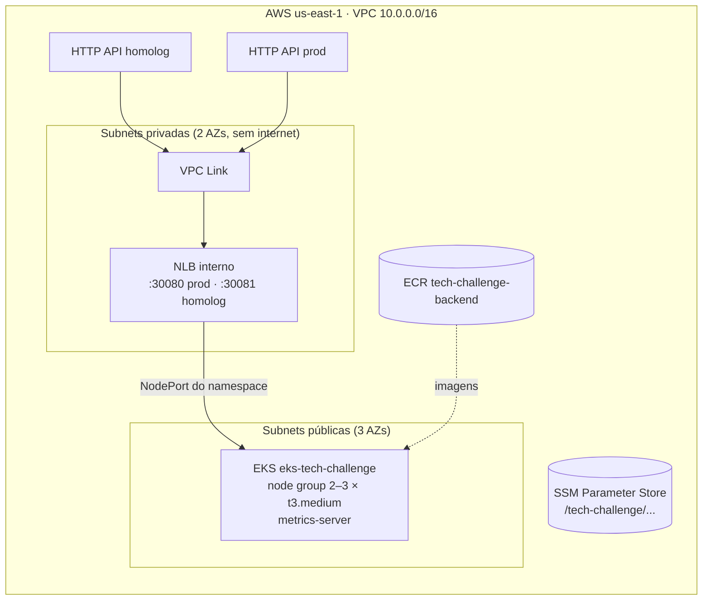

# postech-16soat-infra-k8s

Infraestrutura Kubernetes do Tech Challenge (FIAP/SOAT, Grupo 15, Fase 3), em Terraform:
rede, cluster **Amazon EKS**, registry **ECR**, entrada privada do cluster (**NLB interno + VPC Link**)
e uma **HTTP API do API Gateway por ambiente** (`homolog` e `prod`).

Faz parte de um conjunto de quatro repositórios:

| Repositório | Papel |
|---|---|
| [postech-16soat-infra-k8s](https://github.com/daniellrsouza/postech-16soat-infra-k8s) (este) | Rede, EKS, ECR, NLB, API Gateway |
| [postech-16soat-infra-db](https://github.com/daniellrsouza/postech-16soat-infra-db) | Banco gerenciado (RDS PostgreSQL) |
| [postech-16soat-lambda](https://github.com/daniellrsouza/postech-16soat-lambda) | Autenticação por CPF (Lambda + authorizer) e rotas do gateway |
| [postech-16soat-app](https://github.com/daniellrsouza/postech-16soat-app) | Aplicação Spring Boot no EKS e documentação de arquitetura (`docs/`) |

Ordem de provisionamento: **infra-k8s → infra-db → lambda → app**.

## Arquitetura deste repositório



- **Sem NAT Gateway**: os nós ficam em subnets públicas para baixar imagens; RDS, Lambda,
  NLB e VPC Link ficam nas subnets privadas.
- **Sem ingress controller**: cada namespace expõe a aplicação por um Service `NodePort`
  fixo (`prod` 30080, `homolog` 30081), e o NLB tem um listener por ambiente.
- O gateway injeta `X-Correlation-Id` (= `$context.requestId`) em toda requisição enviada à
  aplicação; o mesmo id aparece nos access logs JSON (`/aws/apigateway/api-tech-challenge-<env>`).
- **Rotas e Lambda Authorizer** não são criados aqui: ficam no repositório
  `postech-16soat-lambda`, que lê o id da API e da integração no SSM.

## Estrutura

```
stacks/
  shared/   VPC, subnets, EKS, node group, ECR, metrics-server, NLB, VPC Link
  env/      por ambiente: namespace, listener/target group, HTTP API, integração
scripts/
  tf.sh     init com o backend da conta + plan/apply/destroy de um stack
.github/workflows/terraform.yml
```

### Contrato com os outros repositórios (SSM Parameter Store)

| Prefixo | Parâmetros |
|---|---|
| `/tech-challenge/shared/` | `vpc-id`, `vpc-cidr`, `public-subnet-ids`, `private-subnet-ids`, `eks-cluster-name`, `eks-cluster-sg-id`, `eks-node-asg-name`, `ecr-repository-url`, `nlb-arn`, `apigateway-vpc-link-id` |
| `/tech-challenge/<env>/` | `k8s-namespace`, `app-node-port`, `apigateway-api-id`, `apigateway-api-endpoint`, `apigateway-execution-arn`, `apigateway-app-integration` |

## Tecnologias

Terraform 1.15 · AWS provider 6 · Helm provider 3 · Kubernetes provider 2 · Amazon EKS 1.36 ·
Amazon ECR · Elastic Load Balancing (NLB) · API Gateway HTTP API · SSM Parameter Store ·
GitHub Actions.

## Execução local

Pré-requisitos: Terraform ≥ 1.15, AWS CLI com as credenciais da sessão do AWS Academy
(`~/.aws/credentials`), Bash.

```bash
scripts/tf.sh shared plan
scripts/tf.sh shared apply
scripts/tf.sh env homolog apply
scripts/tf.sh env prod apply

# kubectl apontando para o cluster
aws eks update-kubeconfig --region us-east-1 --name eks-tech-challenge
```

`scripts/tf.sh` cria, se ainda não existir, o bucket de state `tfstate-<id-da-conta>-postech-16soat`
(versionado, criptografado, sem acesso público) e usa lock nativo do S3. As chaves de state são
`infra-k8s/shared.tfstate` e `infra-k8s/env/<ambiente>.tfstate`.

Para destruir, derrube primeiro os ambientes e depois o compartilhado:

```bash
scripts/tf.sh env homolog destroy
scripts/tf.sh env prod destroy
scripts/tf.sh shared destroy
```

> Conta AWS Academy: só existe a `LabRole` (usada pelo cluster e pelos nós) e a sessão assume a
> role `voclabs`, que recebe acesso de administrador ao cluster via Access Entry.

### Sessões do AWS Academy e nós do cluster

Quando a sessão do lab encerra, o AWS Academy nega todas as chamadas (política `voc-cancel-cred`),
inclusive as da `LabRole` usada pelos nós. Se o node group substituir instâncias nesse intervalo,
as novas sobem mas o `nodeadm` não consegue registrá-las no EKS e desiste
(`exceeded max wait time for InstanceCondition waiter` no console da instância): o cluster fica
sem nós e os pods ficam `Pending`.

Correção: reiniciar as instâncias do node group com a sessão ativa (o `nodeadm` roda a cada boot).
O script `scripts/atualizar-secrets-aws.sh` do repositório
[postech-16soat-app](https://github.com/daniellrsouza/postech-16soat-app) faz essa verificação ao
final e reinicia só os nós não registrados (`SO_VERIFICAR=1` para apenas relatar).

## Deploy (CI/CD)

`.github/workflows/terraform.yml`:

| Evento | O que roda |
|---|---|
| PR para `develop` ou `main` | `fmt`, `validate`, `plan` do shared e do ambiente de destino |
| push na `develop` | `apply` do ambiente **homolog** (environment `homolog`) |
| push na `main` | `apply` do **shared** e do ambiente **prod** (environment `prod`) |
| `workflow_dispatch` | `plan`/`apply`/`destroy` manual de `shared`, `homolog` ou `prod` |

A `main` é protegida e só recebe mudanças por Pull Request. Secrets necessários:
`AWS_ACCESS_KEY_ID`, `AWS_SECRET_ACCESS_KEY` e `AWS_SESSION_TOKEN`, que expiram a cada sessão do lab.

## APIs

Swagger e coleções Postman da aplicação: ver o repositório
[postech-16soat-app](https://github.com/daniellrsouza/postech-16soat-app). As URLs das APIs de
cada ambiente saem no output `api_endpoint` do stack `env` e no parâmetro
`/tech-challenge/<env>/apigateway-api-endpoint`.
